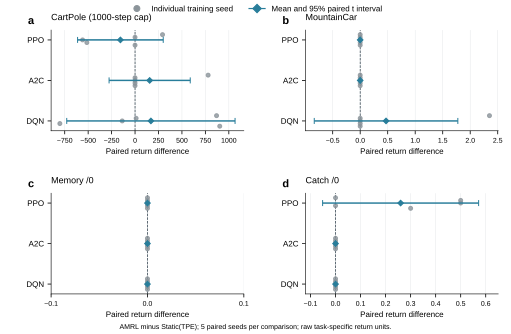
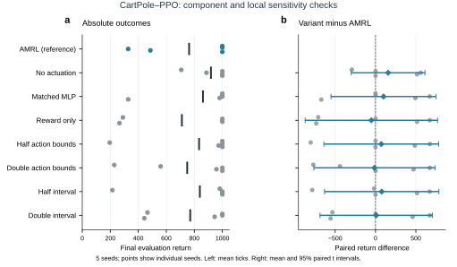
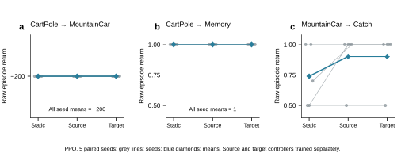
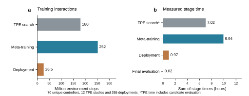

# AMRL-Meta-Net

This repository contains the latest reproducible implementation accompanying the AMRL-Meta-Net revision. It includes the meta-learning controller, single-task baselines, reviewer-focused experiment configurations, validation scripts, and selected publication assets.

## Scope of the released revision

The verified revision contains 265 formal runs across 53 experiment groups, five seeds per group, and 5,300 evaluation episodes. The repository is intended for reproduction and audit of the reported experiments. It does not claim universal superiority across all environments or a general end-to-end compute advantage.

## 1. Environment setup

Use Python 3.10 or newer. The commands below create an isolated environment without committing a machine-specific virtual environment to Git.

```bash
python3 -m venv .venv
source .venv/bin/activate
python -m pip install --upgrade pip
pip install -r requirements.txt
```

Run the pipeline smoke tests before launching a longer experiment:

```bash
pytest -q
```

## 2. Quick runs

A short pilot run is suitable for checking the installation and output schema:

```bash
python -m experiments.run --config configs/review_smoke.json --plan-only
python -m experiments.run --config configs/review_pilot.json
python -m experiments.summarize --input results --output results/summary.csv
```

The `--plan-only` command prints the planned groups and seeds without starting training.

## 3. Reviewer-focused experiments

The full configuration records the main comparison, ablations, transfer checks, and cost accounting used for the revision. Inspect the plan first:

```bash
python -m experiments.run --config configs/review_full.json --plan-only
```

Run the full plan when sufficient compute is available:

```bash
python -m experiments.run --config configs/review_full.json
python -m experiments.summarize --input results --output results/summary.csv
```

The individual environment examples are also available as shell scripts:

```bash
bash scripts/run_cartpole.sh
bash scripts/run_bsuite.sh
```

For Colab, open `colab_run.ipynb` or run `python colab_run.py` after installing the dependencies.

## 4. Regenerating the paper figures

The selected publication figures are stored as editable SVG files under `docs/publication/figures/`. Their source-data tables and validation records are under `docs/publication/source_data/` and `docs/publication/qa/`. To regenerate the figures from the supplied summary data:

```bash
python docs/publication/plot_figures.py
```

The resulting figures cover the paired main comparison, ablation, transfer, cost accounting, cross-algorithm checks, and learning trajectories.









## 5. Interpreting the released results

The revision reports environment-specific behavior rather than a universal ranking. For example, CartPole-PPO favors the static baseline in the paired summary, whereas Catch-PPO favors AMRL; several MountainCar conditions are close to the reward floor and Memory/0 is ceiling-limited. Primary comparisons are evaluated with paired seed-level contrasts and Holm adjustment.

The reported resource accounting separates meta-training, TPE tuning, deployment, and query latency. It should not be read as an end-to-end compute advantage.

## 6. Reproducibility notes

- Seeds, environment names, algorithm labels, and budgets are recorded in the JSON configuration files.
- Raw checkpoints, virtual environments, caches, and large intermediate result directories are intentionally excluded from this submission folder.
- The machine-specific dependency freeze file is excluded because it contains local absolute paths.
- The implementation and protocol details are documented in `docs/IMPLEMENTATION_AND_PROTOCOL.md`.
- The numerical QA records provide the checks used for the revised manuscript and response letter.

## 7. Suggested Git workflow

```bash
git init
git add .
git commit -m "Update AMRL implementation, reviewer experiments, and publication figures"
git branch -M main
git remote add origin https://github.com/yhily/AMRL-Meta-Net.git
git push -u origin main
```

If the repository already has a remote, inspect it with `git remote -v` and use `git push origin main` after reviewing `git diff --cached`.
